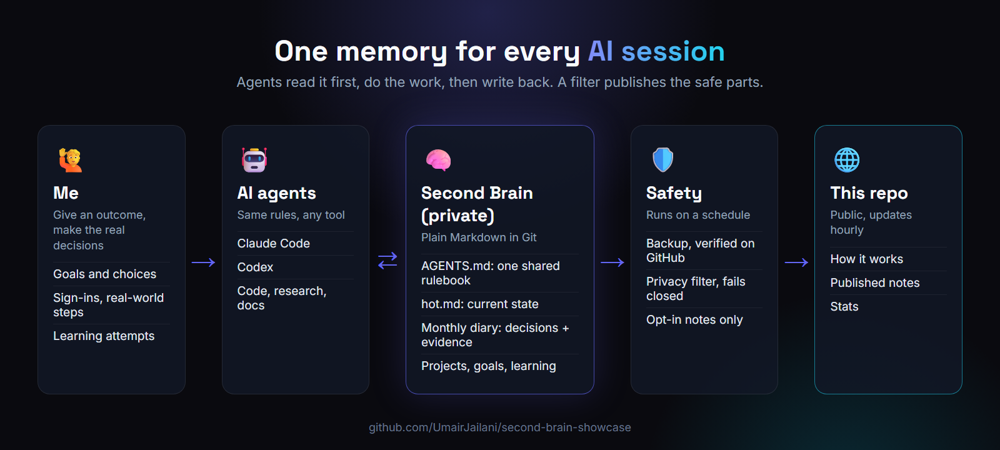
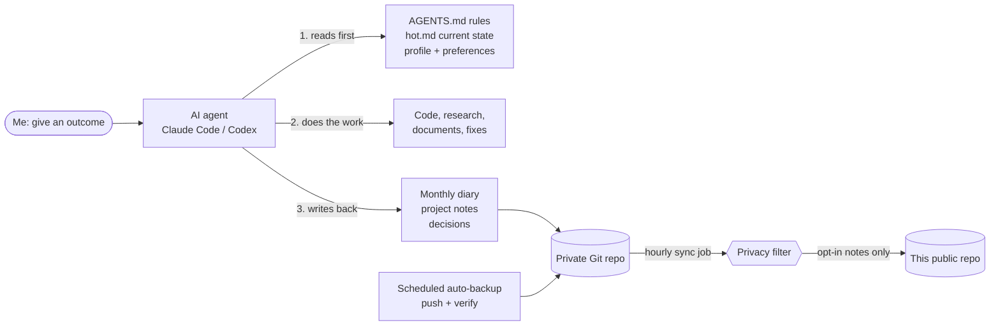

# 🧠 Second Brain: how I run my work with AI agents

**A private, AI-maintained knowledge base that Claude Code and Codex both read and write, so no AI session starts from zero.**

This repo is the public window into it. The real vault stays private. This page and the [notes](notes/) folder update automatically every hour from it, through a [privacy filter](docs/privacy-filter.md).

- **248 notes** in the private vault, **5 published** here
- **518 commits** since 2026-04-07
- Notes per area: resources 102, projects 81, meta 31, areas 12, goals 9, (root) 4, learning 4, folds 3, people 1, reviews 1

---

## The problem

AI coding assistants forget everything between sessions. I use more than one (Claude Code and Codex), on two machines, across very different work: an Android app, job applications, learning Python, business research and home projects. Without a shared memory, every session began with me re-explaining who I am, what's already done and what was decided.

## The idea

Give every AI the same **external memory**: a folder of plain Markdown notes in Git. The AI doesn't "learn". The notes get better, and every new session reads them first.

## The pieces

| Piece | What it does | Why it matters |
|---|---|---|
| **`AGENTS.md` / `CLAUDE.md`** | One set of working rules every agent loads at start: how to communicate, what needs my decision, what to record | Same behaviour from every AI; no repeating myself |
| **`hot.md`** | A short "current state" page: what's in progress and what's waiting on me | A new session is useful in its first minute |
| **Monthly diary** | Dated entries of decisions and evidence | The next session (or a different AI) can pick up exactly where the last stopped |
| **Profile + preferences** | Verified facts about me and how I like to work | Stops AIs inventing or overstating things about me |
| **Wiki folders** | `projects/`, `goals/`, `learning/`, `resources/`, `areas/`, `meta/` | Knowledge sorted by purpose, linked together |
| **Auto-backup** | A scheduled job commits and pushes every repo, then checks GitHub really has it | Built after a real loss (see below) |
| **Audits** | Scripts that find broken links, stale facts and missing metadata | Old facts are treated like bugs |

## What I use it for

- **Building an app.** Every bug, fix and release decision for [Yaad](https://github.com/UmairJailani/yaad-showcase) is logged, so any AI can continue the work safely.
- **Job search.** A dated ledger of applications and an honest, checked profile that CVs are generated from.
- **Learning.** Python, Linux and Japanese, with a rule that the AI gives hints first and lets me try.
- **Research and planning.** Business ideas, tool comparisons and technical references, with sources.
- **Running my computer.** Storage moves, backups and setup changes, each written up so they can be repeated or undone.

## How it was built

| When | What happened |
|---|---|
| **Apr 2026** | Started from the open-source [claude-obsidian](https://github.com/AgriciDaniel/claude-obsidian) template, based on Andrej Karpathy's LLM Wiki idea |
| **Jun 2026** | Added Claude Code hooks to capture `git commit`s from any project into the vault |
| **Aug 2026** | An AI said work was backed up; it wasn't, and the PC crashed. Built the auto-backup that **verifies the push against GitHub** instead of trusting the exit code |
| **Sep 2026** | Moved to Windows and added Codex. Rewrote the rules so Claude and Codex share one rulebook, one profile and one diary |
| **Oct 2026** | Audited the vault: fixed stale facts, broken links and an index that undercounted pages. Freed about 36 GB by moving projects to a second drive using junctions, so every old path still works |
| **Nov 2026** | Built this showcase: opt-in publishing with an automatic privacy filter |

## Lessons (the technical thinking)

1. **Verify, don't trust.** "Pushed successfully" means nothing until the remote is checked. The backup compares local `HEAD` with what GitHub actually has.
2. **External memory, not learning.** The model is the same every session. What improves is the written record it reads at the start.
3. **One source of truth.** Two AIs reading different rule files drift apart. One rulebook, one profile, one diary.
4. **Stale facts are bugs.** A wrong date on a CV came from an old note. Notes now carry `updated` dates, and corrections replace old claims instead of sitting next to them.
5. **Private by default.** Nothing is public unless a note opts in, and the filter fails closed (see [privacy filter](docs/privacy-filter.md)).
6. **Simple beats clever.** A 10-minute scheduled job instead of a file watcher: one moving part is easier to keep healthy.

## Latest published notes

- [Public showcase pipeline](notes/second-brain-showcase.md) · 2026-11-26
- [What other AI second brains have (and what I added)](notes/second-brain-features-research.md) · 2026-11-26
- [Auto Backup System](notes/auto-backup-system.md) · 2026-11-20
- [Working with Codex: hands-off agreement](notes/autonomy-contract.md) · 2026-11-02
- [How It Works](notes/how-it-works.md) · 2026-11-02

[All notes →](notes/)

## Activity

Commits to the private vault per month:

| Month | Commits |
|---|---|
| 2026-04 | ▇▇▇▇▇▇▇▇▇▇▇▇▇▇▇▇ 155 |
| 2026-05 | ▇▇▇▇▇▇ 57 |
| 2026-06 | ▇▇▇▇▇▇▇▇▇ 87 |
| 2026-07 | ▇▇▇▇▇▇▇▇▇▇▇ 110 |
| 2026-08 | ▇▇▇▇ 42 |
| 2026-09 | ▇ 12 |
| 2026-10 | ▇ 6 |
| 2026-11 | ▇▇▇▇▇ 49 |

## Use the idea yourself

- [docs/agent-rules-template.md](docs/agent-rules-template.md): a cleaned-up version of my agent rulebook to adapt
- [tools/sync.py](tools/sync.py) and [tools/publish.ps1](tools/publish.ps1): the privacy filter and the hourly job that publishes this repo

## Credits

- [claude-obsidian](https://github.com/AgriciDaniel/claude-obsidian) by AgriciDaniel (MIT), the vault template this started from
- [Andrej Karpathy's LLM Wiki pattern](https://gist.github.com/karpathy/442a6bf555914893e9891c11519de94f), the underlying idea
- Built and maintained by [Umair Jailani](https://github.com/UmairJailani) with Claude Code and Codex

Last synced from the private vault: 2026-11-26 13:25 UTC
