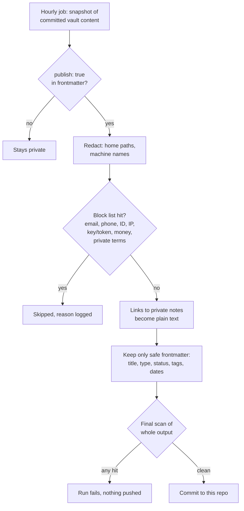

# Privacy filter

The vault holds personal material: family, money, job applications, client work under NDA. This repo is generated from it automatically, so the filter has to be safe even when nobody is watching. It is designed to **fail closed**: when unsure, publish nothing.

## How a note gets here

## The five layers

1. **Opt-in only.** A note is published only when its frontmatter contains `publish: true`. New notes are private by default, so forgetting a flag can never leak anything.
2. **Redaction.** Home-folder paths (for example `C:\Users\name\...`) become `~`, and machine names become "the Windows PC" or "the Linux laptop".
3. **Per-note block.** If a note still contains an email address, phone number, national ID number, IP address, API key or token, money amount, or any term from a private list, the whole note is skipped. It isn't partially censored: a half-redacted note can still give things away.
4. **Link stripping.** Obsidian `[[links]]` to notes that aren't published become plain text, so private note titles don't leak through links. Links between published notes become normal Markdown links.
5. **Final scan.** After the output is built, every file is scanned again with the same rules. Any hit stops the run with an error, so nothing is pushed.

The hourly job ([tools/publish.ps1](../tools/publish.ps1)) builds from a fresh clone of **committed** vault content, so half-written, unsaved notes never reach the filter. After pushing it checks that GitHub really has the new commit.

The private-terms list lives only in the private vault. The filter's code is public in [tools/sync.py](../tools/sync.py); the patterns aren't secret, the data is.

## What I learned building it

- **Allow-lists beat block-lists.** Trying to list everything private is impossible. Listing what is public (opt-in) is easy.
- **Skip, don't censor.** Blacking out one word in a sentence still tells a reader something was there and often what it was.
- **Links leak.** Publishing tools commonly turn a link to a private note into a visible title. Converting those to plain text closes that hole.
- **Two checks, not one.** The per-note check decides what to include; the final scan checks the result, including hand-written pages.
